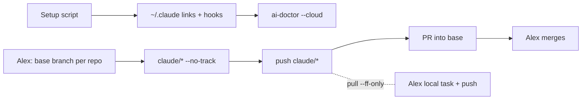

# IMP-20261025-cloud-sessions
*Last updated: 2026-10-25*

## Summary
> Over the 120-line budget: the human kept setup, git rule, links, workspace root and project start in one spec (§ Split Decision).
- **Goal:** A Claude Code cloud session (Projects threads) runs under the same AI Framework as the local profile: system layer, skills, hooks, git backstop, Docker.
- **Scope:** A setup script and a cloud doctor in `ai-dotfiles`; the workspace root files, kept in `tobevisit-docs`, linked into the root locally and in the cloud; a cloud exception to the git rule with its two guards; the `branches:` front-matter key; a link check that refuses links leaving the repo; removal of the unused `preferences.md`; starting a project and its repos from a cloud thread; a README section; three links in `tobevisit-content`.
- **Out of scope:** Cluster access from the cloud, the other site repos, and changing local behaviour.

## Current State
- Cloud threads clone every project repo into `/home/claude/<repo>`, `HOME=/root`; `~/.claude` already holds the harness's own files, so `CLAUDE_CONFIG_DIR` cannot be repointed (checked 2026-10-25).
- `<system>/` resolves to nothing: no system `CLAUDE.md`, no framework skills, 0 of 7 hooks in `hooks.json`, `core.hooksPath` unset in 6 of 6 repos.
- `boundaries.md` § Never do #10 forbids every agent git write; in the cloud the container is reclaimed, so work not pushed is lost, and each thread works on its own `claude/project-thread-<id>` branch cut from the default branch.
- `dockerd` is installed but not running; anonymous Docker Hub pulls return 429, `mirror.gcr.io` pulls succeed.
- Links written for the local layout break `links-check`: 3 in `tobevisit-content` (`../…/env/ai-dotfiles/…`), 1 in `ai-dotfiles` (`docs/baseline-citations.md:50`, `../…/src/github.com/…`).
- `profiles/*/preferences.md`: README says it is appended on render; no script reads it, and its content is stale.
- The workspace root (`CLAUDE.md`, `_canonical.md`, …: repo map, cross-repo spec location, § Shared safety) exists only on Alex's laptop, beside `src/<host>/<org>/<repo>`, `env/ai-dotfiles` and `docs` (= `tobevisit-docs`); the cloud root `/home/claude` has none of them.
- A project starts only on a laptop: `ai-workspace.sh` and `ai-project.sh` scaffold the cwd alone, the list of the workspace's repos is Alex's `mr` (myrepos) `.mrconfig` on the laptop only, and nothing tells a session that a repo lacks the framework.

## Proposed Improvement
- One idempotent script wires the profile into `~/.claude` and the repos; the environment's Setup script becomes `bash ai-dotfiles/scripts/ai-cloud-setup.sh <profile>`.
- In the cloud only, the agent commits and pushes its own `claude/*` branch, cut from the base branch the human names per repo, and opens PRs only into it. Guards enforce it.
- Benefit: `ai-doctor --cloud` in a fresh thread, baseline 4 failure classes (system layer, hooks, hooksPath, Docker), target 0; `links-check` broken links, baseline 3 + 1, target 0.

## Requirements
- FR-1: `scripts/ai-cloud-setup.sh <profile>` MUST link the system layer and every framework skill into `~/.claude` without replacing a non-symlink entry, reusing `scripts/lib/profile-links.sh`.
- FR-2: The script MUST merge the rendered hooks and `env` (`AI_DOTFILES`, `AI_PROFILE`) into `~/.claude/settings.json`, keeping every other key, and be idempotent.
- FR-3: The script MUST set `core.hooksPath` to the framework git hooks in every cloned repo and start `dockerd` with the `mirror.gcr.io` registry mirror when it is not running.
- FR-4: `ai-doctor.sh --cloud` MUST name each missing `~/.claude` link, missing hook, repo without `core.hooksPath` and an unreachable Docker daemon, and exit 1; SessionStart runs it when `CLAUDE_CODE_REMOTE=true`.
- FR-5: `boundaries.md` § Never do #10 MUST gain a cloud exception: with `CLAUDE_CODE_REMOTE=true` the agent asks the human for the base branch of each repo before creating `claude/*` from it (`--no-track`), records it under `branches:`, may commit, `fetch`, `pull --ff-only` and push only that branch, opens its draft PR itself after the first push and only into that base, retargets a PR from its branch whose base differs to that base, and never merges, force-pushes or writes any other branch.
- FR-6: `bash-write-guard.sh` MUST, in cloud mode only, allow creating a `claude/*` branch with `-b`/`-c` and `--no-track`, and `add`, `commit`, `fetch`, `pull --ff-only` and `push` when the current branch and the push target are `claude/*`, never around the pre-commit hook, and keep denying every other git write.
- FR-7: A new PreToolUse hook `pr-base-guard.sh` on GitHub PR-creation tools MUST deny a PR whose base is `master`, `develop`, or differs from the governing spec's `branches:` entry for that repo; in cloud mode `bash-write-guard.sh` MUST deny the `gh pr` verbs that open or change a PR, so PRs go through those tools.
- FR-8: The front-matter schema MUST define optional `branches:` (repo → base branch), and `validate-specs.py` MUST accept it.
- FR-9: `framework/scripts/check-md-links.sh` MUST report a relative link that resolves outside the repo root; `writing-docs` MUST say framework files are cited as `<system>/…`.
- FR-10: The local-layout links (`../…/env/ai-dotfiles/…`, `../…/src/github.com/…`) MUST read as `<system>/…` or repo-name citations: three in `tobevisit-content`, one in `ai-dotfiles` `docs/baseline-citations.md:50`.
- FR-11: `profiles/*/preferences.md` MUST be removed, with README and `docs/ai-agent-framework.md` no longer describing them.
- FR-13: `scripts/ai-workspace-link.sh <root>` MUST link every entry of `docs/workspace/` into `<root>` as a relative symlink, never replacing a real file that differs; in the cloud `ai-cloud-setup.sh` first links `docs` → the clone named by `--docs` (without it the only clone holding `workspace/CLAUDE.md`, never a guess between several), `env/ai-dotfiles`, and `src/<host>/<org>/<repo>` from each clone's `origin`, only when every component is a plain name; `ai-doctor` names a missing root link in both modes.
- FR-14: `tobevisit-docs` MUST hold the workspace root files under `workspace/`.
- FR-15: `ai-doctor` MUST note, without failing, each clone without `_canonical.md` and its three renders (other than the dotfiles and the docs clone) and a docs clone without `workspace/CLAUDE.md` as "not initialised", and in the cloud each `docs/workspace/.mrconfig` section with no clone; `--docs` naming a clone without `workspace/CLAUDE.md` MUST link `docs` and warn, not stop.
- FR-16: `ai-project.sh [<dir>]` and `ai-workspace.sh [<dir>]` MUST scaffold `<dir>` (default the cwd), never overwriting a file; `ai-workspace.sh --docs <clone>` MUST write the root files to `<clone>/workspace/` and the template's `docs/` to `<clone>/`; the cloud exception MUST say that on a "not initialised" note the agent asks the human once per repo and, on yes, scaffolds it on `claude/*`, adds its `.mrconfig` section, opens the PR, and shows rather than merges a `CLAUDE.md` it did not write; `docs/workspace-bootstrap-guide.md` MUST say how a repo, empty or with code, joins the workspace: the human's steps and the agent's.
- FR-17: `docs/workspace/.mrconfig` (myrepos format: a section per repo, its path relative to the root — `docs`, `env/ai-dotfiles`, `src/<host>/<org>/<repo>`, `research/<name>` — and a `checkout = git clone '<url>' '<dir>'`) MUST list the workspace's repos; on a laptop `~/.mrconfig` chains to it and `mr checkout` builds the layout, then `ai-workspace-link.sh` links the root; in the cloud `ai-workspace-link.sh` places each clone at the path of the section whose URL matches its origin (else `src/<host>/<org>/<repo>`), the doctor notes sections with no clone, and a section path that is not plain is refused (FR-13).
- FR-12: README MUST gain a "Cloud sessions" section: one environment per profile, the Setup script line, network (`mirror.gcr.io`), no `CLAUDE_CONFIG_DIR`, dev keys only and no kubeconfig, the mixed cloud/local workflow on one `claude/*` branch, and that the agent, not the UI's PR button, opens PRs.

## Acceptance Criteria
### AC-1: Setup wires a clean home (FR-1, FR-2, FR-3)
Given a temporary `HOME` holding a CLI-owned `settings.json` key and a real `skills/` entry
When `ai-cloud-setup.sh personal` runs twice
Then every link resolves, the CLI key and real entry survive, hooks are not duplicated, each repo has `core.hooksPath`
### AC-2: Doctor names what is missing (FR-4)
Given that wired home with one link, one hook and one repo's `core.hooksPath` removed
When `ai-doctor.sh --cloud` runs
Then it exits 1 and names all three; on the intact home it exits 0
### AC-3: Git writes follow the cloud rule (FR-5, FR-6, FR-8)
Given `CLAUDE_CODE_REMOTE=true`, a spec with `branches:`, and the checked-out branch `claude/x`
When the guard sees `commit`, `push origin claude/x`, `push origin TBV-1`, `push --force`, `merge`, and the same set with the variable unset
Then only the first two pass in cloud mode, and none pass outside it
### AC-4: PR base is the named branch (FR-7)
Given a spec with `branches: {ai-dotfiles: TBV-83-cloud-setup}`
When PR creation is attempted with base `TBV-83-cloud-setup`, `master`, `develop`, `TBV-99`, and `gh pr create` runs in the shell
Then only the first is allowed
### AC-5: Links stay inside the repo (FR-9, FR-10)
Given a fixture doc with a `../../../../env/…` link, and `tobevisit-content` on this change
When each link check runs
Then the fixture is reported, and `make links-check` passes in both repos
### AC-6: A fresh cloud thread runs the framework (FR-11, FR-12)
Given an environment whose Setup script is the README line, after this IMP reaches `master`
When a new thread starts
Then `ai-doctor --cloud` exits 0, a framework skill is listed, an edit no `in-progress` spec governs is denied, and the thread's PR targets the spec's base
Evidence: manual (observation, Projects thread, agent + Alex, date of first run)
### AC-7: The workspace root resolves in both layouts (FR-13, FR-14)
Given a flat fixture of clones (one holding `workspace/CLAUDE.md`) and a local-layout fixture whose root has a differing real `CLAUDE.md`
When the cloud setup and `ai-workspace-link.sh` run twice
Then the cloud root's `CLAUDE.md`, `docs`, `env/ai-dotfiles` and `src/github.com/<org>/<repo>` resolve; the local real file is reported, not replaced; the doctor names a removed root link; with two candidates and no `--docs` no `docs` is linked and the doctor names why; an `origin` with `..` is not placed

### AC-8: A repo without the framework is noted and scaffolded in place (FR-15, FR-16)
Given a clone with code and no `_canonical.md`, one with its own `CLAUDE.md`, an empty docs clone named by `--docs`, and a `.mrconfig` section with no clone
When the cloud setup, the doctor, `ai-project.sh <clone>` and `ai-workspace.sh --docs <clone>` run
Then setup exits 0 with `docs` linked and a warning; the doctor's exit status is unchanged and it names all four; the scaffolds add only missing files and keep the code and the existing `CLAUDE.md`
### AC-9: The workspace is built from `.mrconfig` (FR-17)
Given a `.mrconfig` with `[docs]`, `[env/ai-dotfiles]`, one cloned `src/` section, one cloned `research/` section, one with no clone and one `[src/../x]`, and a laptop root
When the cloud doctor runs, and `mr checkout` then `ai-workspace-link.sh` run on the laptop root
Then the cloud links the cloned `research/` repo at its section path, the doctor notes the missing one and refuses the `..` one; on the laptop each repo lands at its path and the root `.mrconfig` is the link

## Design
### Decisions
- D1: `<system>/` = `~/.claude`, entries linked in — rejected: `CLAUDE_CONFIG_DIR` (hides the harness's own settings, plugins and synced skills).
- D2: Cloud mode keyed on `CLAUDE_CODE_REMOTE=true` — rejected: a flag file written by the script (a local run could inherit it).
- D3: Profile is the script's argument, one environment per profile — rejected: `AI_PROFILE` from environment variables (the Setup script cannot read them).
### Risks / Trade-offs
- `~/.claude/settings.json` may not be honoured by the cloud CLI → first task checks it in a thread; fallback is a committed `.claude/settings.json` per repo.
- `spec-status-guard` / `stop-build-check` were written for the local CLI → the same first task records how they behave in a thread.
### Open Questions
None.
### Flow

## Out of Scope
- OS-1: Cluster commands and kubeconfig in the cloud — § Never do #11 keeps them with the human.
- OS-2: `geeoz-web`, `packages-next.js`, `tobevisit-web` — no cloud-layout defects found.
- OS-4: A Go project needing its physical path under `src/github.com/…` — none of the six repos is one; revisit when one is.
- OS-5: Creating a repo, its working branch, the Claude GitHub App's access and the project's repo list — the human's; the agent starts from a repo that already has the branch the human names.
- OS-3: `tobevisit-content`'s own `check-md-links.sh` adopting FR-9 — that repo's checker, its own spec.

## Split Decision
- Clusters: setup + doctor (FR-1–4), cloud git rule (FR-5–8), links (FR-9, FR-10), cleanup + docs (FR-11, FR-12).
- Triggers: T1 (setup and git clusters test independently), T3 (FR-10 is `tobevisit-content`). Exceptions: none applies.
- Recommendation: `split-recommended` (T1) — siblings `cloud-setup-script`, `cloud-git-rule`, `links-inside-repo`.
- Human decision, 2026-10-25: keep-as-one ("all in one, to close the question"); FR-5–FR-8 ship together in any case. Workspace root (FR-13, FR-14) added in-spec, 2026-10-25, back at `plan`. Starting a project from the cloud (FR-15–FR-17) added in-spec, 2026-10-25 14:40 ("within the current one"), back at `plan`.
- Plan override, 2026-10-25: P3 fires (Tasks 5 and 6 depend on no other task); it repeats Specify trigger T1 on the links cluster, which the human kept in this spec.

## Tasks
> **Before starting Task 1, set status: in-progress in the front-matter above.**

| # | Description | Files | Source files (read-only) | Depends on | Skills | Model | Status |
|---|---|---|---|---|---|---|---|
| 1 | Setup script wiring a profile into `~/.claude` and the repos, idempotent; `make cloud-setup` (FR-1, FR-2, FR-3; AC-1) | `scripts/ai-cloud-setup.sh` *(new)*, `scripts/lib/profile-links.sh`, `scripts/test/ai-cloud-setup.test.sh` *(new)*, `Makefile` | `scripts/ai-profile-init.sh`, `framework/templates/system/claude/hooks.json` | — | writing-specs | default | ☑ done |
| 2 | `ai-doctor.sh --cloud`, run by the SessionStart hook when `CLAUDE_CODE_REMOTE=true` (FR-4; AC-2) | `scripts/ai-doctor.sh`, `scripts/test/ai-doctor.test.sh`, `scripts/test/ai-switch.test.sh` | `scripts/ai-cloud-setup.sh` | 1 | writing-specs | default | ☑ done |
| 3 | Cloud exception to § Never do #10 (incl. agent-opened draft PR and base retarget), `branches:` in the front-matter schema, cloud mode of `bash-write-guard` (FR-5, FR-6, FR-8; AC-3) | `framework/boundaries.md`, `framework/spec-workflows/spec-lifecycle.md`, `framework/hooks/bash-write-guard.sh`, `framework/scripts/test/hooks.test.sh`, `scripts/test/validate-specs.test.sh` | `scripts/validate-specs.py`, `framework/hooks/lib` | — | writing-specs, reviewing-changes | default | ☑ done |
| 4 | `pr-base-guard.sh` on GitHub PR-creation tools, wired in `hooks.json` and documented (FR-7; AC-4) | `framework/hooks/pr-base-guard.sh` *(new)*, `framework/templates/system/claude/hooks.json`, `framework/hooks/README.md`, `framework/scripts/test/hooks.test.sh` | `framework/hooks/spec-status-guard.sh` | 3 | writing-specs, reviewing-changes | default | ☑ done |
| 5 | Link check refuses links leaving the repo; `writing-docs` cites framework files as `<system>/…`; fix `docs/baseline-citations.md:50` (FR-9, FR-10; AC-5) | `framework/scripts/check-md-links.sh`, `framework/scripts/test/check-md-links.test.sh`, `framework/skills/writing-docs/SKILL.md`, `docs/baseline-citations.md` | — | — | writing-docs | default | ☑ done |
| 6 | `tobevisit-content`: the three local-layout links as `<system>/…` citations, PR into `TBV-83-new-categories` (FR-10; AC-5) | `tobevisit-content/docs/improvements-log.md`, `tobevisit-content/docs/specs/archived/CR-20260625-step-9-enrich-catalog-ops-ui.md`, `tobevisit-content/docs/specs/archived/IMP-20260617-admin-ui-design-system.md` | `tobevisit-content/src/scripts/check-md-links.sh` | — | writing-docs | fast | ☑ done |
| 7 | Remove `profiles/*/preferences.md`; README "Cloud sessions" section; framework overview updated (FR-11, FR-12) | `profiles/personal/preferences.md`, `profiles/work/preferences.md`, `README.md`, `docs/ai-agent-framework.md` | `.gitignore` | 1, 2, 3, 4 | writing-docs | default | ☑ done |
| 8 | `make check`, review, PR into `TBV-83-cloud-setup`; AC-6 is observed after Alex takes it to `master` and creates the environment, then Closure Evidence | `docs/specs/active/IMP-20261025-cloud-sessions.md`, `docs/improvements-log.md` | — | 1–7, 9–13 | reviewing-changes | default | ☐ pending |
| 9 | `tobevisit-docs`: Alex sends the root files in the thread; the agent commits them under `workspace/` with Alex's `.mrconfig`, adds its README line, PR into the recorded base (FR-14, FR-17; AC-7) | `tobevisit-docs/workspace/` *(new)*, `tobevisit-docs/README.md` | — | 13 | writing-docs | fast | ☐ pending |
| 10 | `ai-workspace-link.sh`, the cloud layout links in `ai-cloud-setup.sh`, the doctor check, README (FR-13; AC-7) | `scripts/ai-workspace-link.sh` *(new)*, `scripts/lib/workspace-layout.sh` *(new)*, `scripts/ai-cloud-setup.sh`, `scripts/ai-doctor.sh`, `scripts/test/ai-workspace-link.test.sh` *(new)*, `scripts/test/ai-cloud-setup.test.sh`, `scripts/test/ai-doctor.test.sh`, `Makefile`, `README.md` | `scripts/lib/profile-links.sh` | 1, 2 | writing-docs | default | ☑ done |
| 11 | Doctor notes repos without the framework (by the files the four project repos carry today); `--docs` on a clone without `workspace/CLAUDE.md` warns (FR-15; AC-8) | `scripts/ai-doctor.sh`, `scripts/ai-workspace-link.sh`, `scripts/lib/workspace-layout.sh`, `scripts/test/ai-doctor.test.sh`, `scripts/test/ai-workspace-link.test.sh` | `scripts/ai-cloud-setup.sh` | 10 | writing-specs | default | ◐ awaiting approval |
| 12 | `ai-project.sh` and `ai-workspace.sh` take a target, `ai-workspace.sh --docs`; the ask-then-scaffold rule in the cloud exception; the guide's "add a repo to the workspace" (empty or with code) (FR-16; AC-8) | `scripts/ai-project.sh`, `scripts/ai-workspace.sh`, `scripts/test/ai-project.test.sh`, `scripts/test/ai-workspace.test.sh` *(new)*, `framework/boundaries.md`, `docs/workspace-bootstrap-guide.md` | `framework/templates/workspace/`, `framework/templates/project/` | 11 | writing-docs, reviewing-changes | default | ☐ pending |
| 13 | `.mrconfig` sections read by the layout lib, placed by `ai-workspace-link.sh` and checked by the doctor; README: `mr checkout`, then `make workspace-link` (FR-17; AC-9) | `scripts/lib/workspace-layout.sh`, `scripts/ai-workspace-link.sh`, `scripts/ai-doctor.sh`, `scripts/test/ai-doctor.test.sh`, `scripts/test/ai-workspace-link.test.sh`, `README.md` | — | 11 | writing-docs | default | ☐ pending |

## Closure Evidence
Pending — closure only.

## Agent instructions
Per `<system>/boundaries.md` and `<system>/docs/agent-protocol.md`.

## Docs updates required
- README.md, docs/ai-agent-framework.md, framework/boundaries.md, framework/hooks/README.md, framework/spec-workflows/spec-lifecycle.md, framework/skills/writing-docs/SKILL.md — per FR-5, FR-7, FR-8, FR-9, FR-11, FR-12.

## Rollout / migration notes
- Merge to `TBV-83-cloud-setup`, then Alex takes it to `master`; only then the environment is created with the README line. Revert: the PR, and clear the Setup script.
